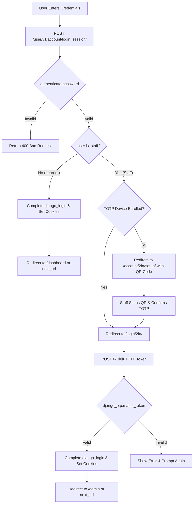

# Requirements

### Overview & Goals
The goal of this initiative is to implement Two-Factor Authentication (2FA / TOTP) into Open edX, enforced **exclusively for staff users** (`user.is_staff == True`), while keeping the login experience completely unchanged and frictionless for learners.

### Feasibility & Complexity Assessment
- **Overall Complexity**: **Low to Moderate** (Estimated ~2-3 engineer days to implement, test, and configure).
- **Recommended Approach**: Leverage **`django-otp`** and its ecosystem (`django-otp-totp`, `django-otp-static`, `qrcode`).
- **Why `django-otp`?**:
  - It is the de-facto Django standard for two-factor authentication, robust, well-maintained, and lightweight.
  - It integrates directly with Django's built-in authentication system and `django.contrib.admin`.
  - It supports standard authenticator apps (Google Authenticator, Microsoft Authenticator, 1Password, Authy) using RFC 6238 TOTP.
  - It avoids disrupting the Open edX learner login pipeline by gating the second factor purely on `user.is_staff`.

### Scope
- **In Scope**:
  - Integration of `django-otp`, `django-otp-totp`, `django-otp-static`, and `qrcode` into Open edX dependencies and settings.
  - Intercepting staff login in `openedx.core.djangoapps.user_authn.views.login` (`login_user` / `LoginSessionView`).
  - Gating 2FA verification strictly for users where `user.is_staff` is `True`.
  - Dedicated server-rendered views and templates for TOTP token verification (`/login/2fa/`) and TOTP device onboarding (`/account/2fa/setup/`).
  - Protecting Django Admin (`/admin/`) in LMS and Studio (CMS) with `OTPAdminSite`.
  - Waffle toggle (`user_authn.enable_staff_2fa`) for safe rollout and emergency bypass.
- **Out of Scope**:
  - 2FA enforcement for general learners (non-staff users).
  - SMS/Hardware security key (WebAuthn/FIDO2) authentication in the initial phase (TOTP + static recovery tokens only).
  - Rewriting frontend single-page app (MFE) login forms — simple server-side redirect flow for staff avoids needing MFE changes.

### User Stories
- **As a System Administrator**, I want all staff accounts to require 2FA so that administrative access to LMS and CMS is protected against credential theft and unauthorized access.
- **As a Staff Member**, I want to easily register my TOTP authenticator app and enter a 6-digit code upon login so that I can securely access staff tools and Django admin.
- **As a Learner**, I want to log in using my regular username/password (or SSO) without any extra 2FA prompts so that my user experience is completely unaffected.

# Technical Design

### Current Implementation
- **Authentication Endpoint**: `openedx.core.djangoapps.user_authn.views.login.login_user` (and `LoginSessionView` at `/user/v1/account/login_session/`) authenticates users using `django.contrib.auth.authenticate` and logs them in via `django.contrib.auth.login` (`_handle_successful_authentication_and_login`).
- **Django Admin**: `lms/urls.py` and `cms/urls.py` mount `admin.site.urls` and currently redirect `/admin/login/` to LMS login via `redirect_to_lms_login`.
- **Filters**: Open edX supports `StudentLoginRequested` filter pipeline step during login processing in `login.py`.

### Key Decisions
1. **Extension Selection (`django-otp`)**:
   - *Decision*: Use `django-otp` with `django_otp.plugins.otp_totp` and `django_otp.plugins.otp_static`.
   - *Rationale*: Minimal footprint, native Django compatibility, built-in Django admin support (`OTPAdminSite`), and zero database modifications needed for non-staff learners.
2. **Staff-Only Interception**:
   - *Decision*: Check `user.is_staff` after password authentication in `login_user`.
   - *Rationale*: Non-staff learners immediately complete login with standard session cookies without ever triggering 2FA. Staff users receive a 2FA challenge redirect.
3. **Dedicated 2FA Verification & Setup Endpoints**:
   - *Decision*: Implement standard Django server-rendered views (`/login/2fa/` and `/account/2fa/setup/`) for staff verification and QR code setup.
   - *Rationale*: Keeps frontend complexity to a minimum, works across LMS and Studio, and requires zero changes to learner-facing JavaScript bundles (`AccessView.js`, `LoginView.js`).
4. **Build & Test Workflow Optimization**:
   - *Decision*: Bypass intermediate per-step package reinstallation and container test runs during active code development.
   - *Rationale*: Container image building and deployment are handled externally by Tutor. Deferring full image builds and test runs until the core implementation is mostly finished maximizes development throughput and eliminates redundant overhead.

### Architecture Diagram


### Proposed Changes

#### 1. Configuration & Dependencies
- `requirements/edx/base.in`: Add `django-otp`, `django-otp-totp`, `django-otp-static`, and `qrcode`.
- `lms/envs/common.py` and `cms/envs/common.py`:
  - Add to `INSTALLED_APPS`:
    - `'django_otp'`
    - `'django_otp.plugins.otp_totp'`
    - `'django_otp.plugins.otp_static'`
  - Add to `MIDDLEWARE` (after `AuthenticationMiddleware`):
    - `'django_otp.middleware.OTPMiddleware'`

#### 2. Auth Flow Interception
- `openedx/core/djangoapps/user_authn/views/login.py`:
  - In `login_user`:
    ```python
    if possibly_authenticated_user.is_staff and is_staff_2fa_enabled():
        device = default_device(possibly_authenticated_user)
        # Store pre-auth user ID and target redirect in signed session
        request.session['pre_auth_staff_user_id'] = possibly_authenticated_user.id
        request.session['pre_auth_staff_next_url'] = redirect_url or next_url
        target_2fa_url = reverse('two_factor_verify') if device else reverse('two_factor_setup')
        return JsonResponse({'success': True, 'redirect_url': target_2fa_url})
    ```

#### 3. 2FA Views & Templates
- `openedx/core/djangoapps/user_authn/views/two_factor.py`:
  - `TwoFactorVerifyView`: Validates TOTP / backup tokens, logs the staff user in using `django_login` and `django_otp.login(request, device)`, sets JWT cookies, and redirects to `next_url`.
  - `TwoFactorSetupView`: Generates a `TOTPDevice`, renders the `otpauth://` QR code via `qrcode`, and activates the device once the user submits a matching confirmation code.
- `lms/templates/student_account/two_factor_verify.html`: Clean, accessible form for 6-digit TOTP token input with link for backup static tokens.
- `lms/templates/student_account/two_factor_setup.html`: QR code display and setup instructions for Google Authenticator / 1Password / Authy.

#### 4. Django Admin Protection
- `lms/urls.py` and `cms/urls.py`:
  - Enable `OTPAdminSite` (`django_otp.admin.OTPAdminSite`) for `/admin/` routes to ensure administrative access requires active OTP verification.

### File Structure
- **Modified**:
  - `requirements/edx/base.in`
  - `lms/envs/common.py`
  - `cms/envs/common.py`
  - `openedx/core/djangoapps/user_authn/views/login.py`
  - `lms/urls.py`
  - `cms/urls.py`
- **Added**:
  - `openedx/core/djangoapps/user_authn/views/two_factor.py`
  - `openedx/core/djangoapps/user_authn/views/tests/test_two_factor.py`
  - `lms/templates/student_account/two_factor_verify.html`
  - `lms/templates/student_account/two_factor_setup.html`

# Testing

### Validation Approach
Verification focuses on two primary criteria:
1. **Staff Security**: Staff users must strictly pass 2FA verification before gaining authenticated staff sessions or Django admin access.
2. **Learner Non-Regression**: Regular learners must experience zero changes, prompts, or performance degradation during login.

*Note*: Comprehensive validation and container environment builds are deferred to the final verification phase (Step 5) since Docker images are built externally via Tutor. Intermediate stages focus strictly on delivering complete, high-quality code changes.

### Key Scenarios
- **Staff User with Configured 2FA**:
  - Submit valid username and password.
  - Verify redirection to `/login/2fa/`.
  - Submit valid 6-digit TOTP code.
  - Verify session creation, JWT cookies, `user.is_authenticated`, `user.is_verified()`, and successful redirection to `/admin` or dashboard.
- **Staff User First-Time Login (No 2FA Configured)**:
  - Submit valid credentials.
  - Verify redirection to `/account/2fa/setup/`.
  - Scan QR code and confirm with initial 6-digit code.
  - Verify device registration and successful session initialization.
- **Non-Staff Learner Login**:
  - Submit credentials for a non-staff user (`is_staff == False`).
  - Verify immediate 200 OK response with `redirect_url` and no 2FA challenge.
- **Django Admin Access**:
  - Access `/admin/` with an unverified staff session and verify OTP enforcement via `OTPAdminSite` / `OTPMiddleware`.

### Edge Cases
- **Invalid OTP Codes**: Entering wrong or expired TOTP codes shows clear error messages without terminating pre-auth session prematurely.
- **Rate Limiting**: Repeated invalid OTP attempts trigger rate-limiting to prevent brute-forcing 6-digit tokens.
- **Static Backup Tokens**: Staff user can use a one-time emergency backup token if their TOTP device is lost or inaccessible.
- **Third-Party Auth (SSO) for Staff**: Staff users authenticating via SSO (SAML/OAuth) are routed through the same 2FA verification step before session activation if staff 2FA is enabled.

# Delivery Steps

### ✓ Step 1: Add django-otp dependencies and configure platform settings
The platform has `django-otp` dependencies installed and configured in settings.

- Add `django-otp`, `django-otp-totp`, `django-otp-static`, and `qrcode` to `requirements/edx/base.in` and recompile requirements.
- Add `django_otp`, `django_otp.plugins.otp_totp`, and `django_otp.plugins.otp_static` to `INSTALLED_APPS` in `lms/envs/common.py` and `cms/envs/common.py`.
- Add `django_otp.middleware.OTPMiddleware` to `MIDDLEWARE` in `lms/envs/common.py` and `cms/envs/common.py` after `AuthenticationMiddleware`.
- Add waffle switches and configuration flags (e.g., `ENABLE_STAFF_2FA`, `ENFORCE_STAFF_2FA_SETUP`) to control rollout safely.

### ✓ Step 2: Implement staff 2FA verification and device enrollment endpoints
Staff users have views and templates to verify TOTP tokens and enroll new TOTP devices with QR codes.

- Implement `TwoFactorVerifyView` in `openedx/core/djangoapps/user_authn/views/two_factor.py` to validate submitted TOTP tokens using `django_otp.match_token`.
- Implement `TwoFactorSetupView` in `openedx/core/djangoapps/user_authn/views/two_factor.py` to generate TOTP secret keys and render QR codes for authenticator apps (Google Authenticator, Authy, etc.).
- Create Mako/HTML templates in `lms/templates/student_account/` for 2FA verification (`two_factor_verify.html`) and device setup (`two_factor_setup.html`).
- Register URL routes in `openedx/core/djangoapps/user_authn/urls.py` and `lms/urls.py` (`/login/2fa/` and `/account/2fa/setup/`).

### ✓ Step 3: Integrate staff 2FA interception into the user authentication flow
Staff users logging in via the primary auth flow are redirected to 2FA verification, while non-staff learners experience no changes.

- Update `login_user` in `openedx/core/djangoapps/user_authn/views/login.py` (or implement a `StudentLoginRequested` filter pipeline step) to check `user.is_staff`.
- If `user.is_staff` is False, proceed with normal single-step authentication and session initialization.
- If `user.is_staff` is True, withhold immediate session creation, stash partial authentication state in session/signed cookie, and return a 2FA redirect (`redirect_url='/login/2fa/'`).
- Handle first-time staff login: if a staff member has no TOTP device registered, redirect to `/account/2fa/setup/`.
- Once 2FA is verified in `TwoFactorVerifyView`, invoke `_handle_successful_authentication_and_login`, issue JWT cookies, and redirect to the staff member's original destination (`next` parameter).

### ✓ Step 4: Secure Django Admin endpoints with OTP protection in LMS and CMS
Django Admin sites in both LMS and CMS enforce OTP authentication for staff administrative access.

- Configure `OTPAdminSite` in `lms/urls.py` and `cms/urls.py` or wrap `admin.site` with OTP protection.
- Ensure admin URL routing (`/admin/login/` and `/admin/`) seamlessly validates 2FA for staff entering the Django administrative dashboard.
- Update LMS and CMS admin login redirects to maintain consistency with the staff 2FA challenge flow.

### ✓ Step 5: Add comprehensive tests and validation for staff 2FA and learner auth flows
Unit and integration tests verify staff 2FA enforcement, enrollment, and regression-free learner login.

- Add unit and integration tests in `openedx/core/djangoapps/user_authn/views/tests/test_two_factor.py` testing successful TOTP validation, invalid OTP codes, rate-limiting, and backup token usage.
- Add test cases in `openedx/core/djangoapps/user_authn/views/tests/test_login.py` ensuring non-staff users log in without 2FA interception.
- Verify Django Admin login enforcement and session persistence under `OTPMiddleware`.